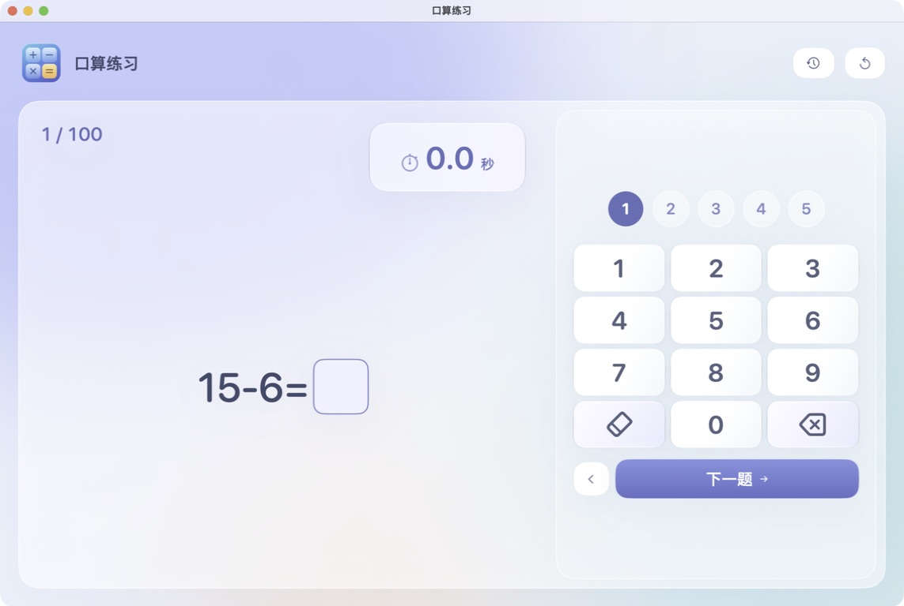
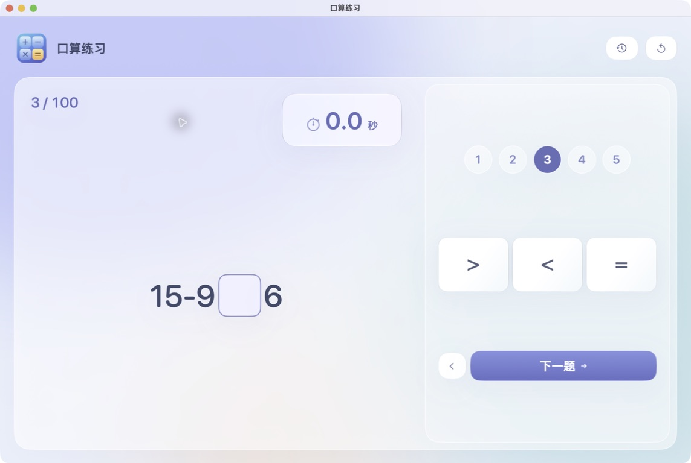
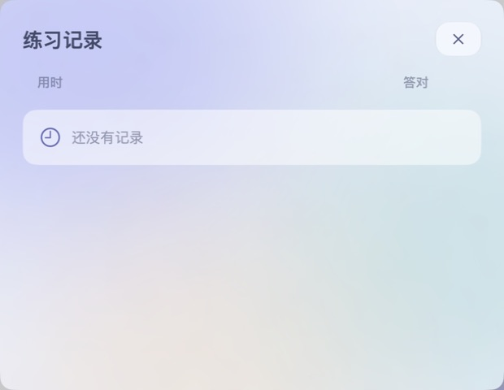
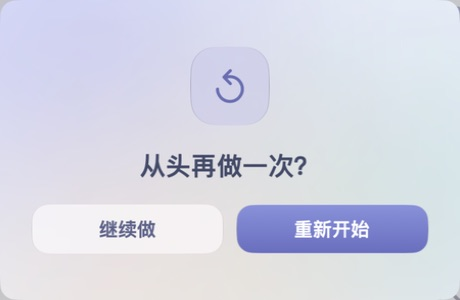

English | [简体中文](README.md)

# Grade 2 Mental Math Practice

> Note: All other documentation in this repository (such as `docs/`) is written in Chinese only.

A native mental math practice app for elementary school grade 2 students, running on macOS / iPhone / iPad. It works fully offline and is built with SwiftUI. The UI is designed for children practicing arithmetic: it highlights problems, timing and input, and keeps textual instructions to a minimum.

## Screenshots

The following are actual screenshots running on macOS. Click an image to view the full-size version.

**Mental Math Practice**



**Comparison**

When switching to comparison problems, the keypad area and the navigation buttons keep their positions.



| Practice History (first launch, no records yet) | Restart Confirmation |
| --- | --- |
|  |  |

## Features

- Start practicing right after launch. Each round has 100 problems covering addition and subtraction, complements, comparisons, and number sequence fill-in-the-blanks.
- Tap the glass numeric keypad, or type with a Mac keyboard; Enter moves to the next blank/next problem, Backspace deletes.
- Only the 5 nearby problems are shown, with support for looking back and switching problem by problem.
- The numeric keypad and the comparison-sign keypad occupy fixed space, keeping the layout stable when switching.
- Timing starts at the first valid input; when finished, the app shows elapsed time, grading results and wrong answers.
- The fastest record only counts rounds with every answer correct, keeping the most recent 50 results and the historical fastest time.
- Progress is saved automatically and can be resumed after quitting; time keeps accumulating for a started round even while the app quits or the Mac sleeps.
- On macOS 26 and later the app uses native Liquid Glass; older versions use frosted material. The system "Reduce transparency" setting is supported.
- Custom restart confirmation card and a practice history panel aligned by column.

## iPhone / iPad Version

iPhone uses a compact portrait layout with a large touch keypad; iPad offers adaptive layouts for both portrait and landscape. Both share the same problem bank, work offline, and save progress locally on each device.

Open [`iPad/Grade2MathPractice.xcodeproj`](iPad/Grade2MathPractice.xcodeproj) in Xcode, select your own signing Team and iPhone / iPad destination, then run. Minimum iOS / iPadOS is 17; you can also import the IPA into LiveContainer. See the [iPhone and iPad installation and verification guide](iPad/README.md) (in Chinese) for details.

## Requirements

- macOS 14 or later; Liquid Glass requires macOS 26 or later.
- Building requires an Xcode toolchain that supports Swift 6; compiling the source code that uses Liquid Glass APIs requires Xcode 26 or a newer SDK.
- By default the app is built for the current Mac architecture; Apple Silicon and Intel need separate builds or a universal binary.

## Build and Package

```sh
swift test
bash scripts/build-app.sh
```

This produces `dist/口算练习.app`. Double-click to open it, or drag it into the "Applications" folder. The script generates the icon and uses local ad-hoc signing; no developer certificate is required. For wide distribution to other Macs, you can add Developer ID signing and notarization.

You can also open `Package.swift` in Xcode and run the `Grade2MathPractice` executable target.

## Project Structure

```text
Sources/PracticeCore/       Problem models, answering, timing, grading and records
Sources/Grade2MathPractice/    SwiftUI interface, keypads and local persistence
Tests/PracticeCoreTests/    Tests for the full 100 problems, timing, coverage and records
scripts/                    App packaging and programmatic icon generation
```

Practice data is stored at `~/Library/Application Support/dev.yangyao.MentalMathGlass/practice.json`. Data is kept only on the local machine: no login, no network requests, and no cross-device sync. The public release uses a separate data directory.

The problem bank contains only math problems, answers and in-app sequence numbers — no student, school, account or session data.

## Practice Wrong Answers from a Record

The practice history shows the number of wrong answers in each round. Newly completed rounds save the specific wrong answers; you can tap "Practice Wrong Answers" to redo exactly those problems, with the problem count matching the actual number of mistakes. Results from wrong-answer practice are labeled separately and do not count toward the full-100-problem fastest record; you can return to the original full-round progress.

Older records still show the number of wrong answers. Only the most recent round whose full answers are still kept can automatically restore the specific wrong problems; other old records with only a total score are marked "old record: specific problems not saved" and offer no entry to redo the wrong answers. Records on Mac, iPhone and iPad are saved separately.
