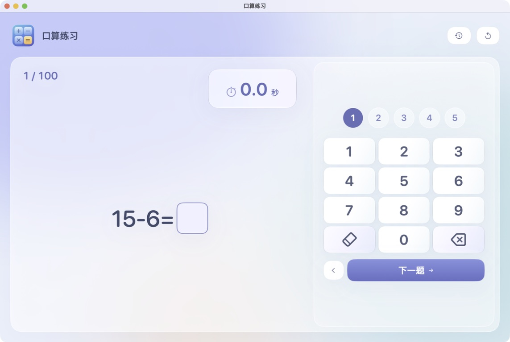
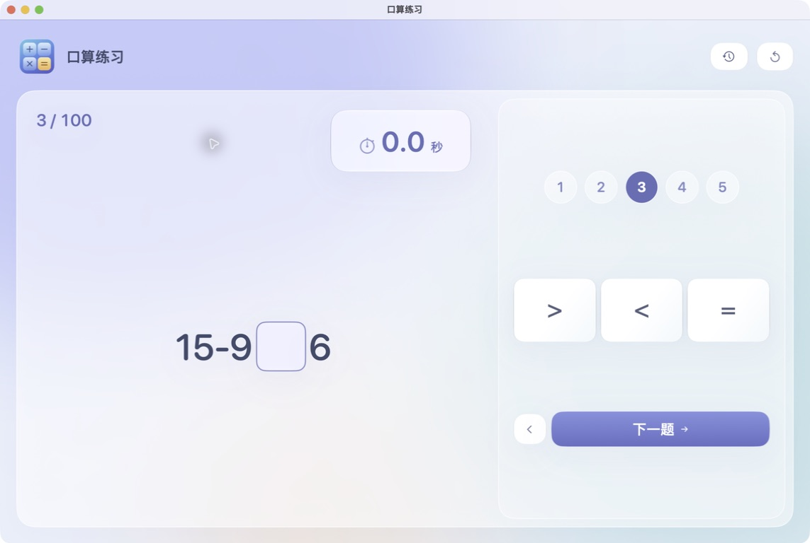
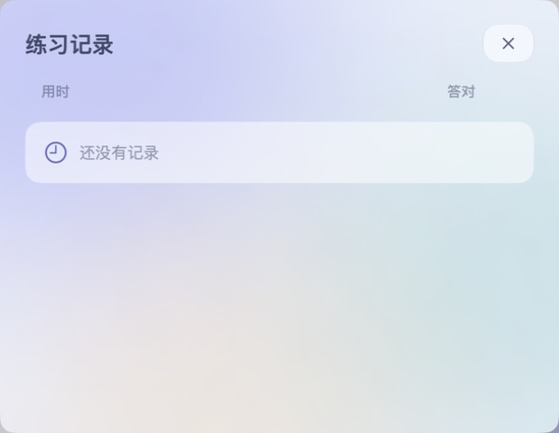
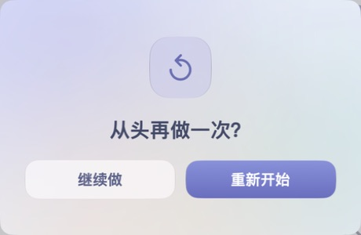

# 小学二年级口算练习

面向小学二年级的 macOS / iPad 原生口算练习应用，可离线使用，使用 SwiftUI 构建。界面为儿童练习设计，突出题目、计时和输入，减少文字说明。

## 界面预览

以下为 macOS 上实际运行的截图。点击图片可查看原图。

**口算练习**



**比较大小**

切换到比较题时，键盘区域和翻题按钮的位置保持不变。



| 练习记录（首次使用，暂无成绩） | 重新开始确认 |
| --- | --- |
|  |  |

## 功能

- 打开直接练习，每轮100道题，涵盖加减法、补数、比较大小和数列填空。
- 点击玻璃数字键盘，或用 Mac 键盘输入；回车进入下一空/下一题，退格删除。
- 只显示附近5道题，支持回看和逐题切换。
- 数字键盘与比较符号键盘占用固定空间，切换时保持布局稳定。
- 第一次有效输入开始计时；完成后显示用时、判题和错题。
- 最快纪录只统计全部答对的练习，保留最近50次成绩及历史最快成绩。
- 自动保存进度，退出后可继续；已开始的本轮在退出或休眠期间也累计时间。
- macOS 26以上使用原生 Liquid Glass，旧版使用磨砂材质；支持系统“减少透明度”设置。
- 自定义重来确认卡片和按列对齐的练习记录面板。

## iPad 版

iPad 版已加入，提供横竖屏自适应布局与大触控按键，适合直接用手指练习。

用 Xcode 打开 [`iPad/Grade2MathPractice.xcodeproj`](iPad/Grade2MathPractice.xcodeproj)，选择自己的签名 Team 和 iPad 后运行。最低 iPadOS 17，详见 [iPad 安装与验证说明](iPad/README.md)。

## 环境

- macOS 14及以上；Liquid Glass需要macOS 26及以上。
- 构建需支持Swift 6的Xcode工具链；使用Liquid Glass API的源码编译需Xcode 26或更新的SDK。
- 本机默认构建当前Mac架构，Apple Silicon与Intel需分别构建或制作通用版本。

## 运行与打包

```sh
swift test
bash scripts/build-app.sh
```

生成 `dist/口算练习.app`，双击打开或拖入“应用程序”目录。脚本生成图标并使用本机ad-hoc签名；不要求开发者证书。向其他Mac广泛分发时，可增加Developer ID签名和公证。

也可以用Xcode打开 `Package.swift`，选择 `Grade2MathPractice` 可执行目标运行。

## 项目结构

```text
Sources/PracticeCore/       题目模型、答题、计时、判题与纪录
Sources/Grade2MathPractice/    SwiftUI界面、键盘和本地保存
Tests/PracticeCoreTests/    完整100题、计时、漏题及纪录测试
scripts/                   app打包与程序化图标生成
```

练习数据保存在 `~/Library/Application Support/dev.yangyao.MentalMathGlass/practice.json`。数据仅存储在本机，不登录、不请求网络，也不进行跨设备同步。公开版使用独立数据目录。

题库资源仅包含数学题、答案和应用内顺序编号，不包含学生、学校、账号或会话数据。

## 按记录练错题

练习记录显示每轮的错题数量。新完成的练习会保存具体错题，可点击“练错题”进入该轮的错题练习，题量按实际错题数显示。错题练习成绩单独标记，不参与整套100题最快纪录；可返回原来的整套练习进度。

旧版本记录仍可显示错题数量。只有当前仍保留完整作答的最近一轮能自动恢复具体错题；其他旧记录若只有总分，将标注“旧记录未保存具体题目”，不提供错误的重练入口。Mac和iPad记录依然分别保存。
